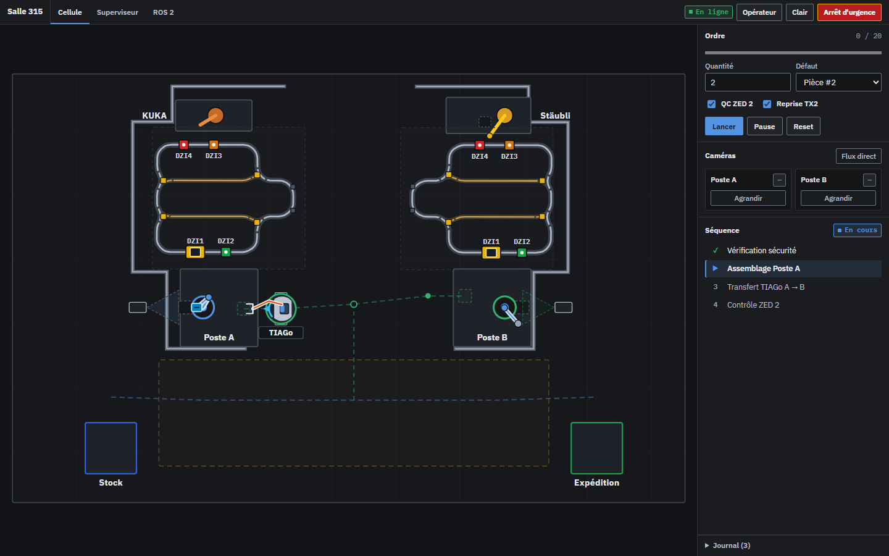

# IHM & Orchestrateur L1 — Salle 315 (MFJA)

Interface web React/Vite et orchestrateur ROS 2 L1 de la cellule de production collaborative de la salle 315 (UPSSITECH — Département SRI).



## Lancer l'IHM

Avec Node.js et npm :

```bash
npm ci
npm run dev
```

Ouvrir [http://localhost:5173](http://localhost:5173) (sous PowerShell : `npm.cmd`). L'IHM fonctionne en mode démo locale ou connectée en WebSocket (`ws://localhost:9090`) à l'orchestrateur L1 / simulation ROS 2 (topics `/usine40/*` et Yaskawa `ros2_control` `/yaskawa_LEFT`, `/yaskawa_RIGHT`).

## Orchestrateur L1 & tests

```bash
# Orchestrateur autonome (pont WebSocket :9090)
python3 scripts/run_orchestrator.py

# Tests unitaires
npm test
```

## Documentation

- [Guide d'utilisation et d'essai](docs/guide-utilisation.md)
- [Architecture IHM et orchestrateur L1](docs/architecture.md)
