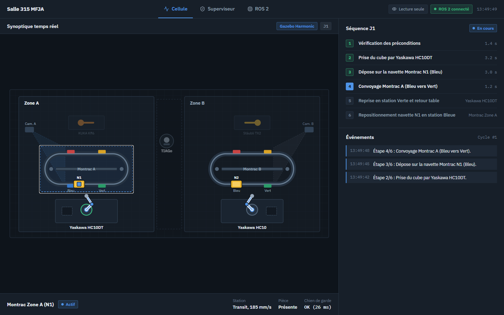

# IHM de supervision et orchestrateur L1 de la salle 315

L’IHM web du projet Usine 4.0 de la MFJA affiche l’état de la cellule, la progression du cycle et les anomalies. Le superviseur L1 exécute des scénarios de démonstration commandés depuis le terminal ou, avec ROS 2 Jazzy, depuis un topic dédié. L’IHM est en lecture seule dans les deux cas.



*Cycle J1 de démonstration alimenté par l’orchestrateur Python en mode autonome. Les poses et états visibles sont synthétiques.*

## Voir l’IHM en deux minutes

Depuis la racine du dépôt, avec Node.js et npm disponibles (vérifié avec Node.js 24) :

```bash
npm ci
npm run dev
```

Ouvrir [localhost:5173](http://localhost:5173), puis cliquer sur **Passer en démo locale**. La barre du bas permet de choisir **J1**, **J1 alt**, **J2 TIAGo**, **J3 VLA** ou **Défaut**, et de suspendre la trace avec **Pause**. Sous PowerShell, utiliser `npm.cmd` si l’exécution des scripts `.ps1` est désactivée.

Pour piloter un cycle de démonstration au terminal et suivre ses états dans l’IHM, démarrer ensuite l’orchestrateur en [mode autonome](docs/guide-utilisation.md#lancer-lorchestrateur-en-mode-autonome).

## Documentation

| Document | Contenu |
| --- | --- |
| [Guide d’utilisation et d’essai](docs/guide-utilisation.md) | Installation Windows et Linux, écrans, commandes, essais J1 et J3, défaut et réarmement, lancement ROS 2 et dépannage. |
| [Architecture et choix techniques](docs/architecture.md) | Flux de données, séquences YAML, contrat ROS 2 et WebSocket, limites et correspondance avec le cahier des charges. |
| [Vidéo de démonstration](docs/images/demonstration-ihm.webm) | Capture de l’IHM connectée au pont local. Elle montre un cycle J1, un rejet J3, un défaut simulé et le retour à l’attente. |

Les deux modes de démonstration utilisent des données synthétiques. Le mode ROS 2 natif publie ces mêmes données sur le graphe ROS. Les essais dans Gazebo et sur le plateau font partie de l’intégration décrite dans le dossier de spécifications.
