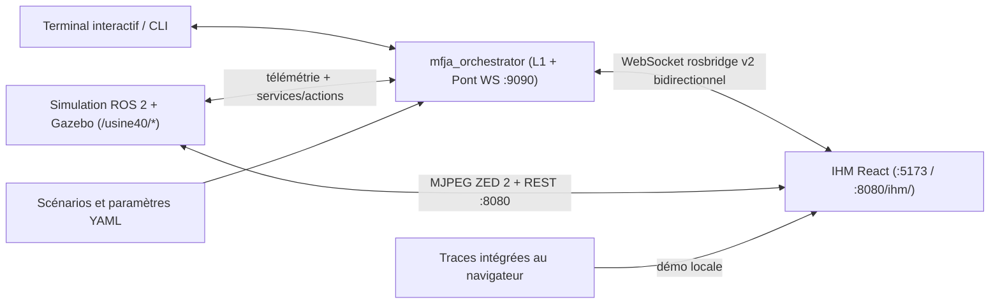

# Architecture et choix techniques

[Retour au README](../README.md) · [Guide d’utilisation et d’essai](guide-utilisation.md)

## Flux unifié IHM, Orchestrateur L1 et Simulation ROS 2 + Gazebo



Le superviseur `mfja_orchestrator` synchronise en temps réel le graphe ROS 2 de la simulation (`/usine40/kpi`, `/usine40/safety/status`, `/usine40/workpieces/active_state`, `/usine40/perception/poste_{a,b}/result`, `/yaskawa_hc10*/joint_states`, `/room_315/rails/*/shuttles/state`, `/usine40/tiago/world_pose`) avec l’IHM React via `ws://0.0.0.0:9090`, et relaie les commandes opérateur (ordres de production, pause, reset, E-Stop, présence opérateur, consignes langage naturel) vers les services `/usine40/*`. Conformément à la topologie physique de la Salle 315, **aucun convoyeur ne relie le Bloc A au Bloc B** : TIAGo assure seul le transfert inter-blocs (`PICK_POSTE_A_DELIVER_POSTE_B`). En mode autonome (`--standalone`), le superviseur fonctionne également hors ROS 2 pour les essais rapides.

Les décisions ci-dessous décrivent le code de la branche et les effets de sa conception.

| Choix observé | Intérêt pour ce lot | Limite actuelle |
| --- | --- | --- |
| **IHM bidirectionnelle et validation L1 fail-closed** | Combine supervision temps réel et pilotage sécurisé : le navigateur s’abonne aux flux WebSocket et émet des requêtes `call_service` / `publish` (`allow_ws_commands: true`) systématiquement filtrées par le répartiteur L1 avant d’atteindre `/usine40/*`, tout en conservant le pilotage CLI et topic ROS. | Le contournement direct vers les actionneurs bas niveau (`send_action_goal`) reste volontairement bloqué côté pont. Le contrôle d’accès réseau relève du déploiement. |
| **Machine à états Python et étapes temporisées** | Rend la séquence reproductible. L’ordre des étapes, le verrouillage et l’acquittement sont faciles à observer et à rejouer. | Les poses et l’avancement sont calculés dans le processus. Les transitions physiques devraient dépendre des retours des équipements. |
| **Séquences et paramètres dans le YAML** | Donne un point d’entrée pour changer l’ordre, les durées, les noms de topics, les seuils et les valeurs de démonstration. J1 et J1 alternatif illustrent deux enchaînements. | Les identifiants d’action correspondent à des branches Python. Une primitive nouvelle demande une implémentation. Certaines poses de démonstration restent définies dans le code. |
| **Instantané JSON partagé** | L’IHM obtient un état cohérent avec un seul message. Le pont renvoie aussi le dernier instantané connu lorsqu’un client s’abonne. | Le schéma dépend du contrat partagé entre Python et TypeScript. Le topic ROS utilise une chaîne JSON. |
| **Vues React et types TypeScript** | Le synoptique, la séquence et les panneaux se mettent à jour à partir du même état. Les types décrivent les champs attendus par chaque vue. Vite sert l’application en développement et assemble les fichiers statiques pour le déploiement. | Le typage intervient à la compilation. À la réception d’un instantané, le client fait une vérification partielle de sa forme. |
| **Traces intégrées et lanceur Python autonome** | Permettent de présenter l’IHM seule, puis de tester le flux complet sans installer ROS ni mobiliser le plateau. | Les traces du navigateur sont distinctes de la séquence YAML. Leurs durées, leurs états et leurs KPI peuvent différer. |
| **Règles J3 et domaine PDDL fourni** | Rend visibles un exemple de rejet topologique et un format de plan candidat. Le domaine exprime qu’une navette se déplace entre deux stations d’un même rail. | Le verdict du prototype est produit par des motifs textuels et des plans écrits en Python. Le fichier PDDL sert de modèle, son interprétation à l’exécution reste à intégrer. |

## États et scénarios

| État L1 | Entrée ou sortie |
| --- | --- |
| `IDLE` | État initial. Un scénario connu peut être lancé. La fin d’un cycle unique, `stop` pendant un cycle ou `reset` ramène à cet état. |
| `RUNNING` | Le superviseur avance à chaque pas de temps. Une étape se termine selon sa durée YAML. En boucle, un nouveau cycle repart automatiquement. Un deuxième démarrage reçoit un message « déjà en cours ». |
| `FAULT_LOCKED` | Un défaut injecté verrouille le scénario et désactive la boucle. L’injection durant un cycle marque l’étape active en défaut. Le démarrage est alors refusé jusqu’à `reset`. |

- **J1** se déroule en zone A. Le HC10DT prend le cube, le dépose sur N1 en station Bleue, puis le reprend en station Verte après le convoyage. La navette retourne en station Bleue.
- **J1 alternatif** envoie d’abord N1 à vide en station Verte. Le bras charge la navette, qui revient en station Bleue pour la reprise.
- **J2** représente le transfert A → B via TIAGo. Chaque rail reste local à sa zone.
- **J3** traite `propose <consigne>`. Les règles rejettent notamment une demande de transfert vers B par Montrac seul, un robot hors périmètre ou une demande reçue en état verrouillé. Certaines mentions de TIAGo et de B sélectionnent J2. Les autres textes tombent par défaut sur J1 ou J1 alternatif. Une consigne incomprise peut donc recevoir un verdict accepté. Un verdict accepté déclenche le scénario uniquement en `IDLE`, même si la réponse textuelle annonce un lancement pendant un cycle en cours.

Le seuil du chien de garde vaut 500 ms dans le YAML. En démonstration, son âge est calculé et le défaut s’injecte par commande. Le message `on_deactivate()` illustre le comportement attendu pour le futur composant matériel. La protection physique et l’arrêt du matériel sont du ressort des dispositifs du plateau et de leur intégration.

Le taux de conformité divise les cycles complétés par la somme des cycles complétés et des cycles interrompus par un défaut. Le temps moyen porte sur les dix derniers cycles complétés, avec une valeur d’initialisation avant le premier résultat. Ce sont des indicateurs en mémoire pour lire le déroulement synthétique.

## Interfaces exécutées

Les noms ci-dessous sont les valeurs par défaut du YAML. **WS** indique une diffusion par le pont intégré. Les publications ROS 2 sont disponibles en mode natif. Les messages `String` de sortie transportent du JSON dans `data`. Le topic de commande transporte le texte de la commande dans ce même champ.

| Topic | Type côté ROS 2 | Direction et transport |
| --- | --- | --- |
| `/mfja/orchestrator/cli_command` | `std_msgs/msg/String` | Entrée ROS 2 |
| `/mfja/supervisor/cell_state` | `std_msgs/msg/String` | Sortie ROS 2 et WS. Instantané principal de l’IHM. |
| `/mfja/safety/status` | `std_msgs/msg/String` | Sortie ROS 2 et WS. État de sécurité. |
| `/mfja/supervisor/events` | `std_msgs/msg/String` | Sortie ROS 2. Les événements figurent aussi dans l’instantané. |
| `/zone_a/montrac/shuttle_state` | `std_msgs/msg/String` | Sortie ROS 2 et WS. Navette N1. |
| `/zone_b/montrac/shuttle_state` | `std_msgs/msg/String` | Sortie ROS 2. N2 figure aussi dans l’instantané. |
| `/zone_a/yaskawa_hc10dt/joint_states` et `/zone_b/yaskawa_hc10/joint_states` | `sensor_msgs/msg/JointState` | Sorties ROS 2. Les valeurs de l’instantané sont exprimées en degrés et le nœud les convertit en radians pour ROS. |
| `/tiago/amcl_pose` | `geometry_msgs/msg/PoseStamped` | Sortie ROS 2. Pose synthétique dans le repère `map`. |
| `/mfja/vla/candidate_plan` | `std_msgs/msg/String` | Sortie ROS 2 et WS. Le plan figure aussi dans l’instantané. |

Le pont WebSocket (`allow_ws_commands: true` par défaut dans `cell_config.yaml`) reconnaît `subscribe`, `unsubscribe`, `publish` (commandes CLI sur `/mfja/orchestrator/cli_command`) et `call_service` (ordres de production `/usine40/supervision/{start_order,pause,reset}`, sécurité `/usine40/safety/{estop,set_human_presence}`, inspection `/usine40/perception/inspect` et consignes langage naturel `/usine40/nl/{parse,approve}`). Toute commande reçue est validée de manière déterministe et fail-closed par `mfja_orchestrator` (rejetant notamment toute requête de convoyeur A↔B) avant d’être relayée au graphe ROS 2 ; les appels bas niveau non autorisés (`send_action_goal`) restent refusés. L’IHM interprète directement l’instantané principal, l’état de sécurité et les réponses `service_response`. Pour les autres topics, le client enregistre l’activité des trames qui lui parviennent.

Voici un exemple d’abonnement émis par le navigateur, suivi d’une trame reçue dont le champ `data` est abrégé :

```json
{"op":"subscribe","topic":"/mfja/supervisor/cell_state","throttle_rate":80}
```

```json
{"op":"publish","topic":"/mfja/supervisor/cell_state","msg":{"data":"{\"orchestratorState\":\"RUNNING\",\"activeScenarioCode\":\"J1\",\"partLocation\":\"montrac_a\"}"}}
```

`cycle_status` et les deux topics `camera/scene_summary` sont déclarés dans la configuration. Les étapes et les observations synthétiques des caméras passent actuellement dans `cell_state`. Les producteurs et fréquences affichés dans l’onglet **ROS 2** proviennent en partie de métadonnées du superviseur. Pour inspecter les producteurs ROS effectivement présents, utiliser `ros2 topic info -v <topic>` dans un environnement ROS 2.

### Où modifier les paramètres

| Fichier | Paramètres ou rôle |
| --- | --- |
| [cell_config.yaml](../ros2_ws/src/mfja_orchestrator/config/cell_config.yaml) | Scénarios, étapes, durées, seuil du chien de garde, port, adresse d’écoute, fréquence et topics. La fréquence de publication est de 10 Hz par défaut. |
| [public/config.json](../public/config.json) | URL WebSocket, source initiale, délai de reconnexion et noms de topics attendus par l’IHM. L’URL enregistrée par le navigateur prend priorité. |
| [supervisor.py](../ros2_ws/src/mfja_orchestrator/mfja_orchestrator/supervisor.py) | États, actions synthétiques, règles `propose` et génération de l’instantané. |
| [orchestrator_node.py](../ros2_ws/src/mfja_orchestrator/mfja_orchestrator/orchestrator_node.py) | Lanceur, CLI, boucle autonome et interfaces ROS 2. `--gz-sim` et `env` changent les libellés associés à l’environnement. |
| [ws_bridge.py](../ros2_ws/src/mfja_orchestrator/mfja_orchestrator/ws_bridge.py) et [rosbridgeClient.ts](../src/services/rosbridgeClient.ts) | Pont WebSocket rosbridge v2 bidirectionnel (`allow_ws_commands`) et client TypeScript (abonnements + appels de services `/usine40/*`). |
| [cell.ts](../src/types/cell.ts) et [demoTelemetry.ts](../src/services/demoTelemetry.ts) | Types d’instantanés côté IHM et traces du mode démo. |
| [salle315_domain.pddl](../ros2_ws/src/mfja_orchestrator/pddl/salle315_domain.pddl) | Domaine de planification fourni pour la suite de J3. |

Pour déplacer le pont sur un autre port, aligner `network.ws_port` et `rosbridgeUrl`. Pour un essai sur une seule machine, `network.ws_host: "127.0.0.1"` limite l’écoute au poste local. La valeur par défaut `0.0.0.0` écoute sur toutes les interfaces IPv4. Le navigateur utilise `localhost` ou l’adresse de l’hôte qui exécute le pont.

## Correspondance avec les documents projet

Le **CDC v2.5** précise les rôles L1 et L7 (§5) et la reprise par les promotions suivantes (§2.3). Le **Dossier de spécifications V4** précise J1 et ses extensions (§3), les fonctions FP et contraintes FC (§4), l’architecture cible (§5) et la validation croisée (§6). Le tableau indique les preuves disponibles sur cette branche et ce qui reste à démontrer pour atteindre la cible.

| Référence | Démonstration actuelle | Validation restante |
| --- | --- | --- |
| CDC L7 et V4 FP4 | Synoptique, étapes, alertes et KPI alimentés par traces locales ou instantanés de l’orchestrateur. | État et anomalies issus du cycle intégré. Arbitrage client sur le lancement et l’arrêt graphiques. |
| CDC L1 et V4 FP5, FC5 | Transitions, arrêt logiciel, verrouillage, refus et acquittement reproductibles en mode autonome. | Interfaces des équipements, préconditions opérationnelles et gestion des retours et erreurs réels. |
| V4 FP1 à FP3 et FP6 | Enchaînement de J1 et variante J1 alternatif dans le superviseur. | Prise et convoyage réels répétés, puis réutilisation des mêmes pilotes pour la variante. |
| V4 FP9 | Scénario J2 synthétique avec transit TIAGo. | Mission Nav2 intégrée, essai de transfert entre les zones et validation des interfaces A/B. |
| V4 FP10, FC3 et FC4 | Structure ROS 2 et drapeau `gz_sim` côté application. | Intégration au jumeau numérique et au matériel, contrôleurs communs et correspondance des essais. |
| CDC L8 et V4 FP7, FP11 | Résumés de scène synthétiques, domaine PDDL et deux verdicts illustrés. | Acquisition caméra, interprétation de la scène, production et validation d’un plan réel si le périmètre est retenu. |
| CDC §2.3 et V4 FC6, FC7 | Installation, parcours rejouables et preuves visuelles dans le dépôt. | Une autre équipe rejoue les essais et consigne les résultats et les écarts. |

Les vidéos et captures de ce dépôt proviennent du navigateur en démo locale ou de l’IHM connectée à l’orchestrateur autonome. Elles attestent le fonctionnement du logiciel dans ces conditions. Un compte rendu d’essai sur le plateau ou dans le jumeau numérique constituera une preuve distincte.
