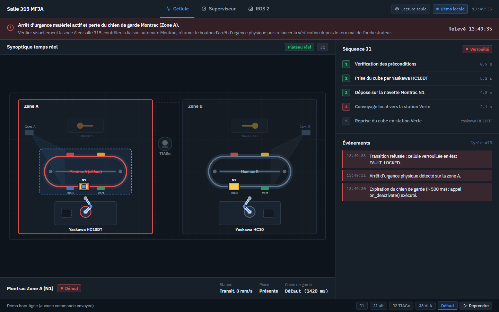
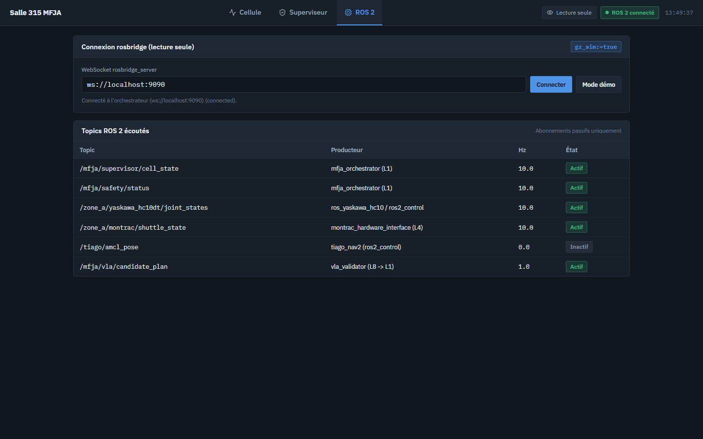
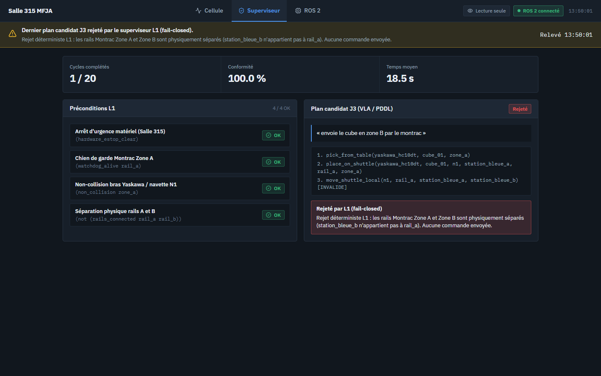
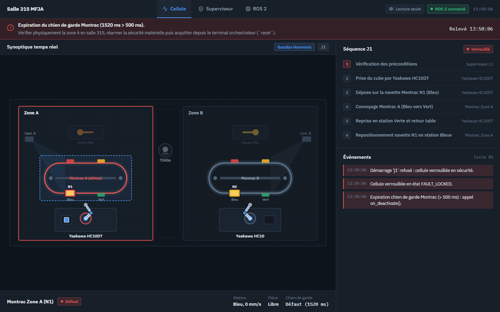

# Guide d’utilisation et d’essai

[Retour au README](../README.md) · [Architecture et interfaces](architecture.md)

## Choisir un mode

| Mode | Prérequis | Ce qu’il permet de vérifier |
| --- | --- | --- |
| Démo locale | Node.js, npm et navigateur | Parcourir des traces intégrées à l’IHM, sélectionner les équipements et lire les états. |
| Orchestrateur autonome | Les mêmes outils, Python 3 et PyYAML | Envoyer des commandes au superviseur et suivre son état synthétique via WebSocket (`ws://localhost:9090`). |
| Simulation complète ROS 2 + Gazebo + IHM | ROS 2 Jazzy, Gazebo Harmonic, `colcon` (`./scripts/build_workspace.sh`) | Connecter bidirectionnellement en direct la simulation complète (`full_usine40_sim.launch.py`), le transfert exclusif Bloc A → Bloc B par TIAGo, les flux ZED 2 (`:8080`) et l’IHM React (`:5173` ou `:8080/ihm/` via `ws://localhost:9090`). |

### Démarrer l’IHM

Dans un premier terminal, depuis la racine du dépôt :

```bash
npm ci
npm run dev
```

Ouvrir [localhost:5173](http://localhost:5173). Si Vite affiche un autre port, utiliser l’URL indiquée dans le terminal. Sous PowerShell, `npm.cmd ci` et `npm.cmd run dev` conviennent aussi.

Au démarrage, l’IHM tente d’ouvrir `ws://localhost:9090`. Pour découvrir l’interface sans Python ni ROS, cliquer sur **Passer en démo locale** en bas de page, ou sur **ROS 2 → Mode démo**. Les boutons du bas changent la trace affichée. **Pause** et **Reprendre** agissent sur la lecture de cette trace.



*Le badge « Démo locale » identifie la source. La trace « Défaut » permet de repérer l’alerte, l’étape interrompue et l’équipement concerné.*

### Lancer l’orchestrateur en mode autonome

Laisser Vite tourner. Dans un deuxième terminal, à la racine du dépôt, créer un environnement Python à côté du dépôt et y installer PyYAML. Garder le terminal interactif pour obtenir l’invite `orchestrateur>`.

**Windows — PowerShell**

```powershell
python -m venv ..\.venv-mfja
& ..\.venv-mfja\Scripts\python.exe -m pip install PyYAML
& ..\.venv-mfja\Scripts\python.exe scripts/run_orchestrator.py --standalone --gz-sim true
```

**Linux — Bash**

```bash
python3 -m venv ../.venv-mfja
../.venv-mfja/bin/python -m pip install PyYAML
../.venv-mfja/bin/python scripts/run_orchestrator.py --standalone --gz-sim true
```

Sur Ubuntu, installer le paquet `python3-venv` si la création de l’environnement indique que `venv` ou `ensurepip` est indisponible.

Dans l’IHM, ouvrir **ROS 2**, saisir `ws://localhost:9090` si nécessaire, puis cliquer sur **Connecter**. Le badge **ROS 2 connecté** indique que la socket est ouverte, y compris dans ce mode autonome. Le libellé **Gazebo Harmonic** provient ici du drapeau `--gz-sim true`. L’origine des données reste le superviseur Python.



*La liste des topics reprend des métadonnées du superviseur. Pour confirmer la réception de l’état, lancer J1 et observer l’évolution de la séquence.*

## Lire les trois écrans

| Écran | À regarder | Action disponible |
| --- | --- | --- |
| **Cellule** | Les deux zones, la position du cube, la séquence active et les trois derniers événements. | Cliquer sur un équipement dans le synoptique pour ouvrir sa fiche. Sur Montrac A, suivre la station, la présence de la pièce et le chien de garde. |
| **Superviseur** | Les cycles complétés, la conformité, le temps moyen, les préconditions et le verdict du plan candidat J3. | Lire la règle bloquée et le motif d’un rejet. Les indicateurs dérivent de la démonstration. |
| **ROS 2** | L’adresse WebSocket, l’état de la connexion et les topics présentés par l’instantané. | Modifier l’adresse, reconnecter l’IHM ou passer en démo locale. Le navigateur mémorise l’adresse saisie. |

## Rejouer les essais

Saisir les commandes ci-dessous à l’invite `orchestrateur>` en [mode autonome](#lancer-lorchestrateur-en-mode-autonome). Les commandes d’injection modifient l’état interne de cette démonstration.

### 1. Suivre un cycle J1

```text
status
start j1
```

Dans **Cellule**, le statut passe d’**Attente** à **En cours**. Suivre les six étapes depuis la vérification initiale jusqu’au repositionnement de N1. Au milieu de la séquence, cliquer sur **Montrac Zone A** pour lire le convoyage de la station Bleue vers la station Verte. Après environ 19 secondes, l’événement de fin apparaît et le superviseur revient à **Attente**. Dans **Superviseur**, le compteur **Cycles complétés** augmente de un.

Voir la [capture du convoyage J1](images/cellule-j1.png). Pour répéter automatiquement le scénario, lancer `start j1 --loop`, puis saisir `stop` pour arrêter la boucle. `start j1_alt` fait partir la navette à vide avant le chargement. `start j2` ajoute un transit représenté par TIAGo entre les zones.

### 2. Rejeter une demande J3

Une fois le superviseur à l’arrêt, saisir :

```text
propose envoie le cube en zone B par le montrac
```

Le terminal indique **REJETÉ par L1**. Dans **Superviseur**, la consigne, l’action invalide et le motif apparaissent dans **Plan candidat J3**. Les rails A et B sont indépendants. Le superviseur reste en attente et le compteur de cycles complétés conserve sa valeur.



Pour comparer avec un cas accepté, saisir `propose fais un cycle en zone A`. Depuis `IDLE`, cette consigne démarre automatiquement un cycle J1 synthétique. L’onglet **Cellule** permet de le suivre.

### 3. Injecter un défaut, vérifier le refus et acquitter

Attendre la fin du cycle précédent, ou saisir `stop`. Lancer ensuite J1 et injecter le défaut avant la fin du cycle :

```text
start j1
fault watchdog
start j1
status
```

La deuxième demande de démarrage est **REFUSÉE**. Dans **Cellule**, la bannière rouge signale l’expiration du chien de garde et l’état passe à **Verrouillé** (`FAULT_LOCKED`). L’étape active porte le défaut. La commande `fault estop` permet de rejouer le cas d’arrêt d’urgence simulé.



Saisir `reset` pour effacer le verrou de la démonstration et vérifier le retour à **Attente** avec `status`. Un nouveau `start j1` lance un cycle depuis le début. Si le dernier candidat J3 a été rejeté, un bandeau jaune peut rester visible après acquittement. Il rappelle le verdict du candidat.

La [vidéo de démonstration](images/demonstration-ihm.webm) montre le déroulé côté IHM en 38 secondes. Les commandes sont saisies dans un terminal hors champ. Repères dans la vidéo : **0:11** dépose du cube sur N1, **0:26** rejet J3, **0:32** verrouillage et refus de démarrage, **0:36** retour à l’attente.

### Commandes du terminal

| Commande | Effet |
| --- | --- |
| `start j1\|j1_alt\|j2 [--loop]` | Lance le scénario choisi. Ajouter `--loop` pour le répéter. |
| `stop` | Interrompt le scénario en cours et désactive la boucle. |
| `status` | Lit l’état, le scénario, l’étape courante et les compteurs. |
| `fault estop\|watchdog` | Injecte le défaut correspondant dans le superviseur. |
| `reset` | Efface les défauts simulés et remet le superviseur à `IDLE`. |
| `propose <consigne>` | Applique les règles J3 du prototype. Une proposition acceptée démarre un cycle si le superviseur est à `IDLE`. |
| `env real\|gazebo` | Change le drapeau d’environnement et les libellés affichés. |
| `help` / `quit` | Affiche l’aide / ferme l’orchestrateur interactif. |

## Démarrer avec ROS 2 Jazzy

Cette procédure ajoute le graphe ROS 2. Elle demande une installation Jazzy fonctionnelle avec `rclpy`, `std_msgs`, `sensor_msgs`, `geometry_msgs` et PyYAML. En mode natif, utiliser l’interpréteur Python de l’environnement ROS. Le lancement ROS 2 et les commandes de cette section sont fournis d’après les interfaces du code. La session de vérification locale a utilisé le mode autonome.

Dans le terminal de l’orchestrateur, à la racine du dépôt, après avoir quitté l’instance autonome :

```bash
source /opt/ros/jazzy/setup.bash
python3 -c 'import rclpy, yaml, std_msgs.msg, sensor_msgs.msg, geometry_msgs.msg'
python3 scripts/run_orchestrator.py --gz-sim true
```

Dans un autre terminal doté du même environnement ROS :

```bash
source /opt/ros/jazzy/setup.bash
ros2 node list
ros2 topic echo /mfja/supervisor/cell_state --once
ros2 topic pub --once /mfja/orchestrator/cli_command std_msgs/msg/String "{data: 'start j1'}"
```

Vérifier la présence du nœud `/mfja_orchestrator`, la réception d’un champ `data` contenant le JSON de la cellule et le début du cycle dans l’IHM. L’aide et la fermeture sont gérées par l’invite interactive. Pour construire et lancer le paquet avec `colcon` depuis la racine du dépôt, dans un environnement où `rosdep` est initialisé :

```bash
source /opt/ros/jazzy/setup.bash
cd ros2_ws
rosdep install --from-paths src --ignore-src --rosdistro jazzy -y
colcon build --symlink-install --packages-select mfja_orchestrator
source install/setup.bash
ros2 launch mfja_orchestrator orchestrator.launch.py gz_sim:=true
```

Le fichier de lancement désactive l’invite. Utiliser le topic de commande et arrêter le processus avec **Ctrl+C**. En cas d’erreur de localisation de `cell_config.yaml` depuis le paquet installé, le lanceur source ci-dessus charge le YAML depuis l’arborescence du dépôt.

## Dépannage

| Symptôme | Vérification |
| --- | --- |
| **ROS 2 hors ligne** | Vérifier que le processus Python tourne et que le port correspond à `network.ws_port` dans le YAML. Saisir l’URL corrigée dans **ROS 2 → Connecter**. Depuis une autre machine, utiliser l’adresse de la machine qui héberge le pont. |
| Le badge est connecté et la séquence reste en attente de données | Vérifier l’événement d’attente et la correspondance entre `topics.cell_state` dans le YAML et `topics.cellState` dans `public/config.json`. Une socket ouverte peut précéder le premier instantané. |
| L’IHM affiche encore des valeurs après une coupure | Regarder le badge de connexion. Le navigateur peut conserver le dernier instantané reçu pendant la reconnexion ou afficher un état d’attente initial dérivé de la démo. |
| `ModuleNotFoundError: No module named 'yaml'` | Installer PyYAML avec le même interpréteur que celui qui exécute le lanceur. |
| Le topic ou le nœud ROS est absent | Contrôler les imports et le chargement de Jazzy, et comparer le `ROS_DOMAIN_ID` des terminaux. En mode autonome, seule la sortie WebSocket est disponible. |
| Le port 9090 est déjà occupé | Arrêter l’instance de démonstration précédente, ou choisir un port libre dans la configuration et reporter le numéro dans l’onglet **ROS 2**. |
